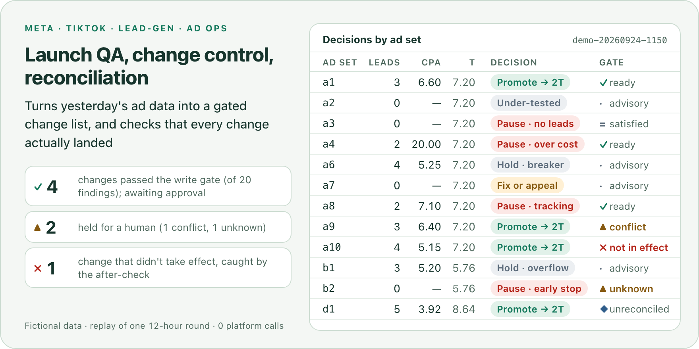
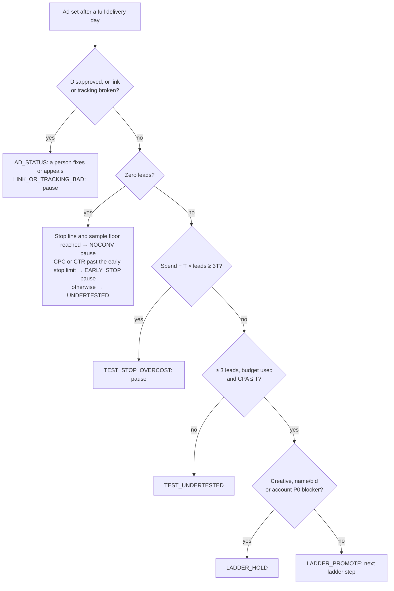
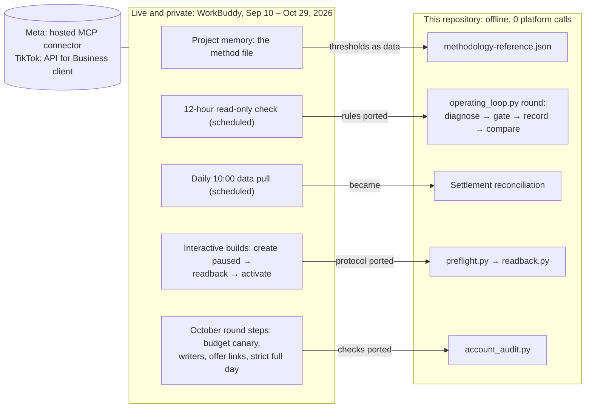
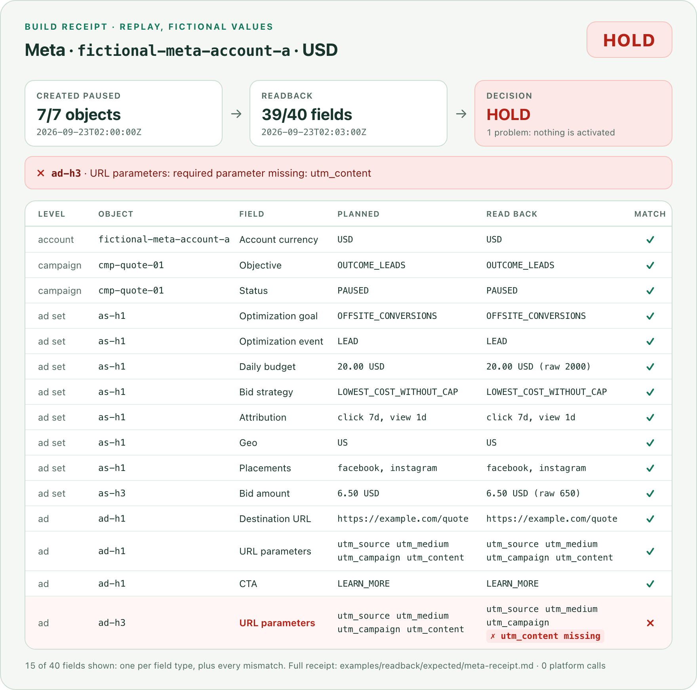

# Ad Ops Agent

[](https://github.com/creator2000212-crypto/ad-ops-agent/actions/workflows/ci.yml) [](.github/workflows/ci.yml)
[](#scope) [](LICENSE)

**English** · [简体中文](README.zh-CN.md)

**Ad-ops guardrails I ran with WorkBuddy (Tencent's desktop AI agent) on live Meta & TikTok lead-gen accounts in Sep–Oct 2026, rebuilt as a tested offline decision engine.**

An Ads Operations portfolio project: launch QA, change control and platform-vs-settlement reconciliation for Meta & TikTok lead-gen, with guardrails that let an AI agent do the repetitive work safely.

- **Launch QA by readback.** Every build is created paused and read back field by field. One mismatch holds the batch, and the receipt shows only what the platform returned.
- **No write without a gate.** Each proposed change is compared with the state read just before writing: `ready`, `satisfied`, `conflict`, `unknown` or `advisory`. `ready` means checked, not approved.
- **Running accounts audited before each round.** A budget canary, writer attribution from the change log, the offer read from each destination link rather than the name, a full day counted from local midnight in the account's time zone, and allow / refuse / wait on every write request: money without a unit, a raise past the ceiling, a partial whole-object update or a resumed human pause is refused.
- **Rules from unit economics, checked against settlement.** T is the target CPA: value per lead × approval rate ÷ target ROAS. An ad set moves up one ladder stage (T → 2T → 3T, i.e. 1, 2 and 3 times the base budget) only after a full day at CPA ≤ T, and stop lines are counted in T. Every threshold is read from a methodology file, with no code defaults. Cost decisions turn advisory when platform numbers don't reconcile with the settlement export.

```bash
git clone https://github.com/creator2000212-crypto/ad-ops-agent.git && cd ad-ops-agent
python3 demo/run_demo.py   # Python 3.9+, standard library only; no account, no API key
```

Operated Sep 10–Oct 29, 2026 · open-sourced Sep 24–25 · 12-hour check ran Sep 22–26 and Oct 24–29 → [How it ran](docs/how-it-ran.md) · what ran live vs what is new: [Real vs demo](docs/capability-status.md)

<p align="center"></p>
<p align="center"><sub>Generated from the demo round by <code>scripts/render_visuals.py</code>; no number is typed by hand.</sub></p>

## What it catches

Each row is something that went wrong while I operated the accounts or built this repo, and the closest guard in this repo.

| What went wrong (2026) | Guard in this repo |
|---|---|
| **Sep 10** · A batch of 25 creatives timed out; existing objects were reconciled before the retry | An object in the readback that the plan does not contain (a duplicate from a retry) holds the build.<br><sub>[`test_extra_object_from_a_retried_request_holds`](tests/test_readback.py)</sub> |
| **Sep 17** · A bulk activation left 8 ads inactive; field readback after activation caught it | After any change the after-state is compared field by field, and a write that did not land stays open as "not in effect" (a10 in the image above). Activation itself is not replayed here.<br><sub>[`test_reconcile_detects_a_write_that_did_not_take_effect`](tests/test_operating_loop.py) · [`test_status_must_be_paused_before_activation`](tests/test_readback.py)</sub> |
| **Sep 20** · A scheduled watch got 0 accounts because the ad-platform connection had dropped; it reported "no data" and drew no conclusions | Missing is never zero: a snapshot with no accounts is refused and a missing ledger raises.<br><sub>[`test_snapshot_without_accounts_is_rejected`](tests/test_operating_loop.py) · [`test_missing_ledger_raises`](tests/test_operating_loop.py)</sub> |
| **Sep 20** · The daily sheet, pulled from every connected account, ran 19.6% above the partner's settlement export | Platform vs settlement reconciliation: a row on one side only is reported as a scope gap, never zero-filled; an out-of-tolerance account turns cost decisions advisory.<br><sub>[`test_platform_only_account_is_scope_and_never_zero_filled`](tests/test_reconciliation.py) · [`test_gap_makes_a_promotion_advisory`](tests/test_reconciliation.py)</sub> |
| **Sep 20** · Build scripts hard-coded audience automation off, against the standing rule | Not yet checked: audience automation is not a readback or pre-flight field ([WB-10](docs/case-studies.md#wb-10)). Settings and thresholds live in data files, and readback refuses a plan that does not state the fields it checks.<br><sub>[`test_rules_never_fall_back_to_a_code_default`](tests/test_operating_loop.py) · [`test_plan_must_state_fields_it_wants_checked`](tests/test_readback.py)</sub> |
| **Sep 22** · Agent-written automated rules had thresholds in dollars where the API takes cents, and paused ad sets | Build budgets and bids convert by the currency's minor-unit offset; an unknown currency is refused. Automated rules themselves are not modeled here.<br><sub>[`test_budget_minor_units_follow_currency_offset`](tests/test_readback.py)</sub> |
| **Sep 22** · The agent activated a batch after a reply that answered a different question | `ready` and ACTIVATE mean "checked", never "approved"; approval names the batch ([AGENTS.md](AGENTS.md) R1).<br><sub>[`test_only_ready_rows_enter_the_write_plan`](tests/test_operating_loop.py)</sub> |
| **Sep 25** · A receipt generator hard-coded `ACTIVE` while the readbacks said `PAUSED` | Receipt values come only from the readback file; a missing field is "not returned".<br><sub>[`test_receipt_status_comes_from_readback_not_plan`](tests/test_readback.py)</sub> |
| **Sep 25** · My own bug in this repo, fixed the same day: a missing or null baseline passed the gate as `ready` | A missing or null baseline is `unknown`, never `ready`.<br><sub>[`test_null_baseline_is_unknown_even_when_current_is_null`](tests/test_operating_loop.py)</sub> |
| **Oct 15** · Ad sets rebuilt in another account copied their source budgets and spent a day's budget within minutes | Pre-flight fails a moved ad set that starts above the moved-ad-set budget.<br><sub>[`test_moved_adset_with_copied_budget_fails`](tests/test_preflight.py)</sub> |
| **Oct 25** · A workflow wrote a budget meant in cents into a field that takes dollars; three ad sets ran at 20–200× for about 1.6 hours | Money without an explicit unit is refused, a raise to the ceiling or above is refused, a large raise needs a reason, a rollback is never held, and a P0 canary runs every round.<br><sub>[`test_money_without_unit_is_refused_not_guessed`](tests/test_account_audit.py) · [`test_budget_at_p0_line_is_p0_even_when_paused`](tests/test_account_audit.py)</sub> |
| **Oct 25** · A budget set yesterday afternoon counted as a full day, at a fixed UTC offset after the account's zone changed | A full day starts at local midnight in the account's named time zone; a short change log gives "unknown".<br><sub>[`test_named_time_zone_follows_the_daylight_saving_change`](tests/test_account_audit.py) · [`test_short_change_log_gives_unknown_not_yes`](tests/test_account_audit.py)</sub> |
| **Oct 27** · 91% of one account's spend went to an offer no ad set name mentioned | The offer comes from each ad's destination link; the name is only checked against it.<br><sub>[`test_name_and_link_disagree`](tests/test_account_audit.py)</sub> |
| **Oct 27** · An outside application made 22 budget changes in 48 hours; no ad set kept one budget for a full day | Every change in the log is attributed to its writer; an outside writer's values are not the baseline.<br><sub>[`test_outside_writer_is_named_with_its_net_changes`](tests/test_account_audit.py)</sub> |
| **Oct 28** · A paused batch would have run eight live ad sets twice and raised one account's budget about 2.5× | A paused ad set with the same offer and creative as a live one is flagged with the budget jump.<br><sub>[`test_paused_copy_of_a_live_ad_set_is_flagged_with_the_budget_jump`](tests/test_account_audit.py)</sub> |

## How it decides

One round has five steps: **diagnose** each ad set against the methodology → **gate** every proposed change against the state read just before writing → **record** the ready rows in an append-only ledger → **compare** with the after-state → **hand over** what is still open. `python3 demo/run_demo.py --steps` walks through them one at a time. Policy keys for each rule are in the [decision matrix](docs/decision-matrix.md).

| Rule | Code and test |
|---|---|
| T = value per lead × approval rate ÷ target ROAS | `target_cost()`<br><sub>`test_target_is_price_times_approval_over_roas`</sub> |
| Promote one ladder stage (T → 2T → 3T) on enough leads at CPA ≤ T over a full day | `decide_account()`<br><sub>`test_healthy_stage_promotes_and_doubles_budget` · `test_promotion_from_2T_targets_3T`</sub> |
| Stop lines are counted in T; no verdict below the sample floor | `decide_account()`<br><sub>`test_overcost_margin_triggers_stop` · `test_zero_conversion_below_sample_gate_is_not_judged`</sub> |
| Fix the creative or the account before adding budget | `promotion_blockers()`<br><sub>`test_breaker_blocks_promotion` · `test_account_p0_blocks_promotion`</sub> |
| One creative taking the spend at a high CPA trips a breaker | `creative_findings()`<br><sub>`test_circuit_breaker_fires_on_concentration_and_cost`</sub> |
| Platform and settlement must agree before cost decisions | `reconcile_settlement()`<br><sub>`test_settled_leads_are_compared_with_the_approval_rate`</sub> |
| Five-state write gate on the state read before writing | `gate()`<br><sub>`test_conflict_when_current_value_matches_neither_baseline_nor_target`</sub> |
| A change counts only when the after-state shows it | `reconcile()`<br><sub>`test_reconcile_detects_a_write_that_did_not_take_effect`</sub> |
| Why CPA moved: CPM, CTR and CVR terms (new here) | `cpa_driver_decomposition()`<br><sub>`test_known_inputs_split_exactly`</sub> |
| Build readback before activation | `verify_build()`<br><sub>`test_missing_url_parameter_holds_activation`</sub> |
| Pre-flight lint before anything is created (new here) | `lint()`<br><sub>`test_max_name_with_cost_cap_fails`</sub> |
| Account audit before the round decides: canary, live definition, offer links, writers, full day | `audit()` in `account_audit.py`<br><sub>`test_active_ad_set_without_active_ad_is_a_shell` · `test_budget_set_yesterday_afternoon_has_no_full_day`</sub> |
| Every write request checked for unit, ceiling, raise, locked and whole-object fields | `judge_request()`<br><sub>`test_partial_targeting_is_refused_with_the_keys_it_would_clear` · `test_resuming_a_human_pause_is_refused`</sub> |

<details>
<summary><strong>Decision tree for one ad set</strong></summary>


</details>

Promotions and over-cost stops on an account whose platform numbers don't reconcile with the settlement become advisory; every remaining proposal then goes through the five-state write gate.

From the [decision matrix](docs/decision-matrix.md), which is generated from the methodology and drift-checked:

<!-- excerpt: docs/decision-matrix.md -->
| Code | Severity | Trigger | Response window | Engine or human |
|---|---|---|---|---|
| `LADDER_PROMOTE` | P1 | At least 3 leads over a full delivery day and the step's own CPA ≤ T | After 2-3 full delivery days | Engine: proposes `daily_budget` to the next ladder step through the write gate; advisory when the settlement does not reconcile |
| `LADDER_HOLD` | P2 | Promotion numbers are met, but the ad set has a creative breaker, more than 8 creatives or a MAX name on a capped bid, or the account has a P0 finding | Next round | Engine: detects; advisory, a person acts |
| `TEST_STOP_OVERCOST` | P0 | Spend − T × leads ≥ 3T | Immediately | Engine: proposes `status` → PAUSED through the write gate; advisory when the settlement does not reconcile |
| `AD_STATUS` | P0 | configured_status ACTIVE but effective_status DISAPPROVED | Within 2 hours | Engine: detects; advisory, a person acts |
<!-- /excerpt -->

**Why CPA moved.** CPA = CPM ÷ (1000 × CTR × CVR), so the change in log CPA splits exactly into a CPM, a CTR and a CVR term (log-points, with each term's share of the move). A positive term pushed CPA up; a negative one pulled it down. In this excerpt from the [demo report](demo/expected/report.md), the a4 jump is almost all CVR, so the place to look is after the click (destination, form, lead quality), not the auction. It is an accounting identity, not a causal claim.

<!-- excerpt: demo/expected/report.md -->
| Ad set | CPA: prior → now | Δ log CPA | CPM effect | CTR effect | CVR effect | Main driver |
|---|---|---|---|---|---|---|
| `fictional-adset-a1` | 7.03 → 6.60 | -6.3 | +2.5 (22%) | -6.7 (60%) | -2.0 (18%) | **CTR** |
| `fictional-adset-a4` | 5.41 → 20.00 | +130.8 | +9.8 (7%) | +3.2 (2%) | +117.7 (90%) | **CVR** |
<!-- /excerpt -->

## How it ran in WorkBuddy

The rules are ported from the read-only 12-hour check I ran as a scheduled job in WorkBuddy on live Meta and TikTok lead-gen accounts (Sep 22–26 and Oct 24–29, 2026). Builds ran interactively: create paused → field-by-field readback → activate. This repo is the offline, tested version.

**Why WorkBuddy.** I needed one agent that could do the whole job on my own machine:

- work on local files: the creative library, ffmpeg frame checks, Python scripts, and CSV, Excel and HTML outputs;
- call Meta and TikTok from the same session, through an MCP connector and an API client;
- run the scheduled jobs (the daily pull and the 12-hour check) without a separate server;
- keep project memory and reusable skills between sessions, so the rules carried over instead of being re-explained;
- work in Chinese, the language I operate and report in.

Nothing in this repository depends on WorkBuddy; see [Use it with your agent app](#use-it-with-your-agent-app).



| WorkBuddy job | What it did | Runs | Outcome |
|---|---|---|---|
| Daily 10:00 data pull (created Sep 20) | Pulled yesterday's Meta and TikTok data into a fixed 20-column sheet; named a missing source instead of zero-filling it; never merged a stale file | 7 (Sep 21–26) | 5 delivered, 1 failed, 1 interrupted manual test |
| 12-hour read-only check (created Sep 22) | Re-verified the last round's actions in an append-only ledger → pulled → classified each ad set on the T ladder → action list → report | 7 (Sep 22–26) | 6 delivered, 1 failed |
| 2-hour watch (Sep 20, deleted the same day) | Its only run got 0 accounts because the ad-platform connection had dropped | 1 | Reported "no data, no conclusions" |
| 12-hour check, resumed (Oct 24) | Same round on a second connector, with four steps first: budget canary, writer attribution, offer codes from links, strict full day | 9 (Oct 24–29) | 9 delivered; 4 with 2 of 5 accounts unreachable, stated |

Both recurring jobs ran on the app's local scheduler, only while the laptop was awake. Both were paused on Sep 26; the 12-hour check was resumed on Oct 24 for the October rounds. The 12-hour check was read-only by instruction, not by permission. Run log, timeline and limits: [How it ran](docs/how-it-ran.md).

<p align="center"></p>
<p align="center"><sub><code>readback.py</code> on the Meta fixture · full receipt: <a href="examples/readback/expected/meta-receipt.md">meta-receipt.md</a> · <a href="docs/build-qa.md">Build QA</a></sub></p>

## Use it with your agent app

The project is not tied to one agent app. [`AGENTS.md`](AGENTS.md) holds the operating rules for any agent, the engine is plain Python (standard library, JSON in and out, one command per step), and the [connection routes](docs/platform-connectivity.md) are vendor-neutral. Any agent app that can read files and run shell commands can use it.

| Agent app | How it picks up the rules |
|---|---|
| Codex and other tools that read `AGENTS.md` | Open the repository folder as the project |
| Claude Code | [`CLAUDE.md`](CLAUDE.md) imports `AGENTS.md` |
| WorkBuddy and other desktop agents | Open the folder as the project and ask the agent to read `AGENTS.md` first, or add it to the project rules |

To confirm the rules actually loaded: [project loading](docs/use-in-agent.md).

## Case studies

Twenty-two cases from the live accounts, each ending in a guardrail here ([all cases](docs/case-studies.md); how the method changed: [methodology history](docs/methodology-history.md)). September's happened while builds were made:

- [WB-01](docs/case-studies.md#wb-01): 20 proposed ads held for review before creation → duplicate-file check in pre-flight
- [WB-02](docs/case-studies.md#wb-02): a TikTok build for three business lines, handed off object by object → field-by-field readback receipt
- [WB-03](docs/case-studies.md#wb-03): the daily report labeled incomplete when a source was missing → missing is not zero
- [WB-04](docs/case-studies.md#wb-04): automated rules with a 100× unit error traced, reversed and made notify-only → currency-aware money
- [WB-05](docs/case-studies.md#wb-05): every round starts by checking the last round's actions → append-only ledger
- [WB-06](docs/case-studies.md#wb-06): a receipt that hard-coded `ACTIVE` caught in review → receipts only from timed readback
- [WB-07](docs/case-studies.md#wb-07): a 0-account run reported "no data", not "all healthy" → empty input fails loudly
- [WB-08](docs/case-studies.md#wb-08): activation after an ambiguous reply → an explicit approval gate
- [WB-09](docs/case-studies.md#wb-09): daily sheet vs settlement gap closed from about 20% to about 0.1% → settlement reconciliation
- [WB-10](docs/case-studies.md#wb-10): build scripts that contradicted a standing rule fixed and audited → settings as data, not code

October's happened on accounts that were already running ([account audit](docs/account-audit.md)):

- [WB-11](docs/case-studies.md#wb-11): a budget written in the wrong unit → money needs a unit, a ceiling and a canary
- [WB-12](docs/case-studies.md#wb-12): names that said one offer while links carried another → the offer comes from the link
- [WB-13](docs/case-studies.md#wb-13): an outside application changing budgets between rounds → writer attribution first
- [WB-14](docs/case-studies.md#wb-14): a full day counted from the wrong midnight → local midnight in the named time zone
- [WB-15](docs/case-studies.md#wb-15) to [WB-22](docs/case-studies.md#wb-22): shells counted as live, locked and whole-object fields, a duplicate paused batch, moved budgets, pixel availability, an evening budget cut, a resumed human pause, disabled accounts

## Who did what

I defined the operating rules, thresholds and write-gate behavior from campaigns I ran, and I approved launches and budget changes; the agent executed them. The WorkBuddy skills, scripts and scheduled jobs were created by the agent at my direction. This repository's code and docs were drafted with AI coding agents; I specified and reviewed the decision engine and its tests.

## Scope

> **Offline by design.** Every module here reads local files (JSON; SQLite for the prototype's simulation and private-memory store) and makes 0 platform calls; the fixtures are fictional. The live reads and writes ran through WorkBuddy's connectors, normally under my approval (the two exceptions, [WB-04](docs/case-studies.md#wb-04) and [WB-08](docs/case-studies.md#wb-08), are why automated rules became notify-only and launch approval an explicit gate), and none of that access ships with this repository. The planning and onboarding modules (`onboarding.py`, `guidance.py`, `methodology.py`, `planning.py`, `task.py`, `adops.py` and their helpers) are a separate pre-launch prototype, not part of what ran live. Details: [Real vs demo](docs/capability-status.md).

## Repository map

| Path | What it is |
|---|---|
| [`operating_rules.py`](operating_rules.py) | Rules, settlement reconciliation, CPA drivers and the five-state write gate |
| [`operating_loop.py`](operating_loop.py) | One round (diagnose → gate → record → compare) and the append-only ledger |
| [`readback.py`](readback.py) · [`preflight.py`](preflight.py) | Build readback receipt (HOLD / ACTIVATE) and pre-flight lint |
| [`account_audit.py`](account_audit.py) | Audit of running accounts and write requests before a round decides ([Account audit](docs/account-audit.md)) |
| [`demo/`](demo/README.md) · `examples/` | The replay with committed expected output (English and Chinese); fictional fixtures for `operating/`, `readback/`, `preflight/`, `audit/` |
| [`docs/`](docs/index.en.md) | How it ran, case studies, build QA, account audit, decision matrix, methodology history |
| [`AGENTS.md`](AGENTS.md) · [`CLAUDE.md`](CLAUDE.md) | Instructions for an agent that uses this project on real accounts; `CLAUDE.md` loads them in Claude Code |
| `scripts/` · `tests/` | Decision-matrix and image renderers, repository checks; unittest suites (`python3 -m unittest discover -s tests`) |

## License

[MIT](LICENSE). [NOTICE](NOTICE.md) · [CHANGELOG](CHANGELOG.md) · [SECURITY](SECURITY.md) · [Contributing](CONTRIBUTING.md). No private campaign records, credentials, media or WorkBuddy session data are in this repository. This project is not affiliated with Tencent.
