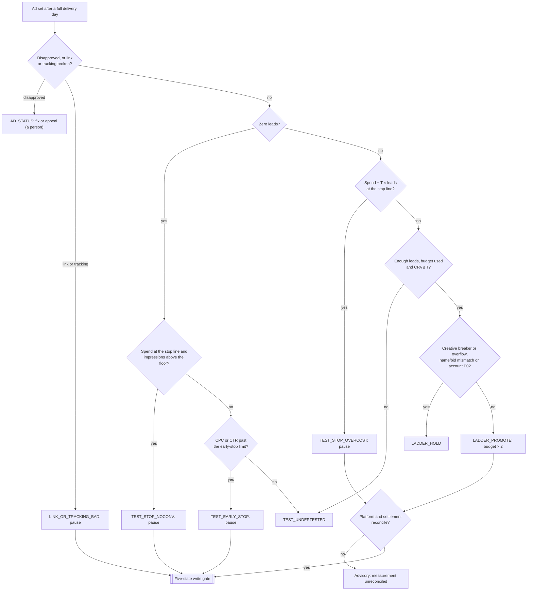
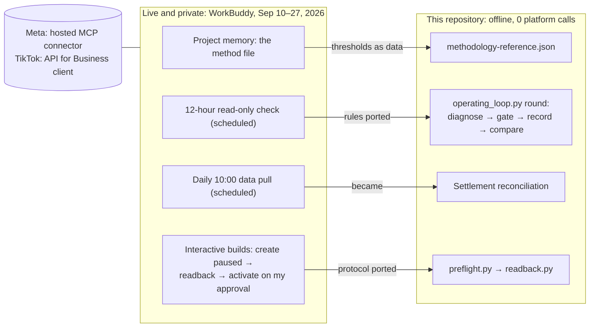

# Ad Ops Agent

[](https://github.com/creator2000212-crypto/ad-ops-agent/actions/workflows/ci.yml) [](.github/workflows/ci.yml)
[](#scope) [](LICENSE)

**English** · [简体中文](README.zh-CN.md)

**Ad-ops guardrails I ran with an AI agent (WorkBuddy) on live Meta & TikTok lead-gen accounts in Sep 2026, rebuilt as a tested offline decision engine.**

- **Launch QA by readback.** Every build is created paused and read back field by field. One mismatch holds the batch, and the receipt shows only what the platform returned.
- **No write without a gate.** Each proposed change is compared with the state read just before writing: `ready`, `satisfied`, `conflict`, `unknown` or `advisory`. `ready` means checked, not approved.
- **Rules from unit economics.** T = value per lead × approval rate ÷ target ROAS. Budgets climb T → 2T → 3T and stop lines are counted in T, all read from a methodology file with no code defaults.

```bash
git clone https://github.com/creator2000212-crypto/ad-ops-agent.git && cd ad-ops-agent
python3 demo/run_demo.py   # Python 3.9+, standard library only; no account, no API key
```

Operated Sep 10–27, 2026 · open-sourced Sep 24–25 · scheduled jobs paused since Sep 26 → [How it ran](docs/how-it-ran.md)

<p align="center"></p>
<p align="center"><sub>Fictional data · replay. Every number in the image is computed from the demo round by <code>scripts/render_visuals.py</code>.</sub></p>

## What it catches

Each row is something that went wrong while I operated the accounts, and the check that now stops it.

| Failure on live accounts (2026) | Guard in this repo | Proof |
|---|---|---|
| Sep 10: a batch of 25 creatives timed out; existing objects were reconciled before the retry | An object in the readback that the plan does not contain (a duplicate from a retry) holds the build | `test_extra_object_from_a_retried_request_holds` |
| Sep 17: a bulk activation left 8 ads inactive; field readback caught it | Status is read back per object, never assumed from the request; ACTIVATE needs every object paused and every field matching the plan | `test_status_must_be_paused_before_activation` |
| Sep 20: a run that got 0 accounts still wrote a healthy-looking report | Missing is never zero: an empty snapshot is refused and a missing ledger raises | `test_missing_ledger_raises` |
| Sep 20: the daily sheet ran 19.6% above the partner's settlement export | Platform vs settlement reconciliation; an out-of-tolerance account turns cost decisions advisory | `test_gap_makes_a_promotion_advisory` |
| Sep 20: build scripts hard-coded a setting that contradicted the standing rule | Thresholds come only from the methodology file | `test_rules_never_fall_back_to_a_code_default` |
| Sep 22: agent-written automated rules had thresholds in dollars where the API takes cents, and paused ad sets | Money converts by the platform's currency offset; an unknown currency is refused | `test_budget_minor_units_follow_currency_offset` |
| Sep 22: the agent activated a batch after a reply that answered a different question | `ready` and ACTIVATE mean "checked", never "approved"; approval names the batch | [AGENTS.md](AGENTS.md), `test_only_ready_rows_enter_the_write_plan` |
| Sep 25: a receipt generator hard-coded `ACTIVE` while the readbacks said `PAUSED` | Receipt values come only from the readback file; a missing field is "not returned" | `test_receipt_status_comes_from_readback_not_plan` |
| Sep 25, my own bug: a missing or null baseline passed the gate as `ready` ([34a36a6](https://github.com/creator2000212-crypto/ad-ops-agent/commit/34a36a6)) | A missing or null baseline is `unknown`, never `ready` | `test_null_baseline_is_unknown_even_when_current_is_null` |

## How it decides

One round has five steps: **diagnose** each ad set against the methodology → **gate** every proposed change against the state read just before writing → **record** the ready rows in an append-only ledger → **compare** with the after-state → **hand over** what is still open. `python3 demo/run_demo.py --steps` walks through them one at a time.

| Rule | Policy key | Function | Test |
|---|---|---|---|
| T = value per lead × approval rate ÷ target ROAS | `target_roas`, `quality_factor` | `target_cost()` | `test_target_is_price_times_approval_over_roas` |
| Promote T → 2T → 3T on enough leads at CPA ≤ T over a full day | `ladder`, `promotion` | `decide_account()` | `test_healthy_stage_promotes_and_doubles_budget` |
| Stop lines are counted in T; no verdict below the sample floor | `stop_loss`, `sample_gate` | `decide_account()` | `test_overcost_margin_triggers_stop`, `test_zero_conversion_below_sample_gate_is_not_judged` |
| Fix the creative or the account before adding budget | `actions` → `LADDER_HOLD` | `promotion_blockers()` | `test_breaker_blocks_promotion`, `test_account_p0_blocks_promotion` |
| One creative taking the spend at a high CPA trips a breaker | `creative_rules` | `creative_findings()` | `test_circuit_breaker_fires_on_concentration_and_cost` |
| Platform and settlement must agree before cost decisions | `reconciliation` | `reconcile_settlement()` | `test_settled_leads_are_compared_with_the_approval_rate` |
| Five-state write gate on the state read before writing | — | `gate()` | `test_conflict_when_current_value_matches_neither_baseline_nor_target` |
| A change counts only when the after-state shows it | — | `reconcile()` | `test_reconcile_detects_a_write_that_did_not_take_effect` |
| Why CPA moved: CPM, CTR and CVR terms | — | `cpa_driver_decomposition()` | `test_known_inputs_split_exactly` |
| Build readback before activation | build plan | `verify_build()` | `test_missing_url_parameter_holds_activation` |
| Pre-flight lint before anything is created | `examples/preflight/policy.json` | `lint()` | `test_max_name_with_cost_cap_fails` |

<details>
<summary><strong>Decision tree for one ad set</strong></summary>


</details>

From the [decision matrix](docs/decision-matrix.md), which is generated from the methodology and drift-checked:

<!-- excerpt: docs/decision-matrix.md -->
| Code | Severity | Trigger | Response window | Engine or human |
|---|---|---|---|---|
| `LADDER_PROMOTE` | P1 | At least 3 leads over a full delivery day and the step's own CPA <= T | 2-3 full delivery days | Engine: proposes `daily_budget` ×2 through the write gate; advisory when the settlement does not reconcile |
| `LADDER_HOLD` | P2 | Promotion numbers are met, but the ad set has a creative breaker, more than 8 creatives or a MAX name on a capped bid, or the account has a P0 finding | Next round | Engine: detects; advisory, a person acts |
| `TEST_STOP_OVERCOST` | P0 | Spend - T x leads >= 3T | Immediately | Engine: proposes `status` → PAUSED through the write gate; advisory when the settlement does not reconcile |
| `AD_STATUS` | P0 | configured_status ACTIVE but effective_status DISAPPROVED | Within 2 hours | Engine: detects; advisory, a person acts |
<!-- /excerpt -->

**Why CPA moved.** CPA = CPM ÷ (1000 × CTR × CVR), so the change in log CPA splits exactly into a CPM, a CTR and a CVR term (log-points, with each term's share of the move). In this excerpt from the [demo report](demo/expected/report.md), the a4 jump is almost all CVR, so the place to look is after the click (destination, form, lead quality), not the auction. It is an accounting identity, not a causal claim.

<!-- excerpt: demo/expected/report.md -->
| Ad set | CPA: prior → now | Δ log CPA | CPM | CTR | CVR | Main driver |
|---|---|---|---|---|---|---|
| `fictional-adset-a1` | 7.03 → 6.60 | -6.3 | +2.5 (22%) | -6.7 (60%) | -2.0 (18%) | **CTR** |
| `fictional-adset-a4` | 5.41 → 20.00 | +130.8 | +9.8 (7%) | +3.2 (2%) | +117.7 (90%) | **CVR** |
<!-- /excerpt -->

## How it ran in WorkBuddy

The rules are ported from the read-only 12-hour check I ran as a scheduled WorkBuddy (Tencent's desktop AI agent; not affiliated) job on live Meta and TikTok lead-gen accounts (Sep 22–26, 2026). Builds ran interactively: create paused → field-by-field readback → activate. This repo is the offline, tested version.



| WorkBuddy job | What it did | Runs | Outcome |
|---|---|---|---|
| Daily 10:00 data pull (created Sep 20) | Pulled yesterday's Meta and TikTok data into a fixed 20-column sheet; named a missing source instead of zero-filling it; never merged a stale file | 7 (Sep 21–26) | 5 delivered, 1 failed, 1 interrupted manual test |
| 12-hour read-only check (created Sep 22) | Re-verified the last round's actions in an append-only ledger → pulled → classified each ad set on the T ladder → action list → report | 7 (Sep 22–26) | 6 delivered, 1 failed |
| 2-hour watch (Sep 20, deleted the same day) | Its only run got 0 accounts after the connector's authorization dropped | 1 | Reported "no data, no conclusions" |

Both recurring jobs ran on the app's local scheduler, only while the laptop was awake, and have been paused since Sep 26. The 12-hour check was read-only by instruction, not by permission. Run log, timeline and limits: [How it ran](docs/how-it-ran.md).

<p align="center"></p>
<p align="center"><sub>Fictional data · replay of <code>readback.py</code> on the Meta fixture. The full receipt is <a href="examples/readback/expected/meta-receipt.md">meta-receipt.md</a>; see <a href="docs/build-qa.md">Build QA</a>.</sub></p>

## Case studies

Ten incidents from the live accounts, each ending in a guardrail here ([all cases](docs/case-studies.md); how the method changed: [methodology history](docs/methodology-history.md)):

- [WB-01](docs/case-studies.md#wb-01): 20 proposed ads held for review before creation → duplicate-file check in pre-flight
- [WB-02](docs/case-studies.md#wb-02): a three-line TikTok build handed off object by object → field-by-field readback receipt
- [WB-03](docs/case-studies.md#wb-03): the daily report labelled incomplete when a source was missing → missing is not zero
- [WB-04](docs/case-studies.md#wb-04): automated rules with a 100× unit error traced, reversed and made notify-only → currency-aware money
- [WB-05](docs/case-studies.md#wb-05): every round starts by checking the last round's actions → append-only ledger
- [WB-06](docs/case-studies.md#wb-06): a receipt that hard-coded `ACTIVE` caught in review → receipts only from timed readback
- [WB-07](docs/case-studies.md#wb-07): a 0-account run reported "no data", not "all healthy" → empty input fails loudly
- [WB-08](docs/case-studies.md#wb-08): activation after an ambiguous reply → an explicit approval gate
- [WB-09](docs/case-studies.md#wb-09): daily sheet vs settlement gap closed from about 20% to about 0.1% → settlement reconciliation
- [WB-10](docs/case-studies.md#wb-10): build scripts that contradicted a standing rule fixed and audited → settings as data, not code

## Who did what

I defined the operating rules, thresholds and write-gate behaviour from campaigns I ran, and I approved launches and budget changes; the agent executed them. The WorkBuddy skills, scripts and scheduled jobs were created by the agent at my direction. This repository's code and docs were drafted with AI coding agents; I specified and reviewed the decision engine and its tests.

## Scope

> **Offline by design.** Every module here reads JSON files and makes 0 platform calls; the fixtures are fictional. The live reads and writes ran through WorkBuddy's connectors under my approval, and none of that access ships with this repository. The planning and onboarding modules (`onboarding.py`, `guidance.py`, `methodology.py`, `planning.py`, `task.py`, `adops.py` and their helpers) are a separate pre-launch prototype, not part of what ran live. Details: [Real vs demo](docs/capability-status.md).

## Repository map

| Path | What it is |
|---|---|
| [`operating_rules.py`](operating_rules.py) | Rules, settlement reconciliation, CPA drivers and the five-state write gate |
| [`operating_loop.py`](operating_loop.py) | One round (diagnose → gate → record → compare) and the append-only ledger |
| [`readback.py`](readback.py) · [`preflight.py`](preflight.py) | Build readback receipt (HOLD / ACTIVATE) and pre-flight lint |
| [`demo/`](demo/README.md) · `examples/` | The replay with committed expected output (English and Chinese); fictional fixtures for `operating/`, `readback/`, `preflight/` |
| [`docs/`](docs/index.en.md) | How it ran, case studies, build QA, decision matrix, methodology history |
| [`AGENTS.md`](AGENTS.md) | Instructions for an agent that uses this project on real accounts |
| `scripts/` · `tests/` | Decision-matrix and image renderers, repository checks; unittest suites (`python3 -m unittest discover -s tests`) |

## License

[MIT](LICENSE). [NOTICE](NOTICE.md) · [CHANGELOG](CHANGELOG.md) · [SECURITY](SECURITY.md) · [Contributing](CONTRIBUTING.md). No private campaign records, credentials, media or WorkBuddy session data are in this repository.
