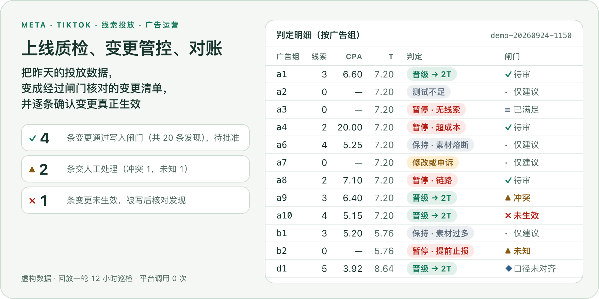
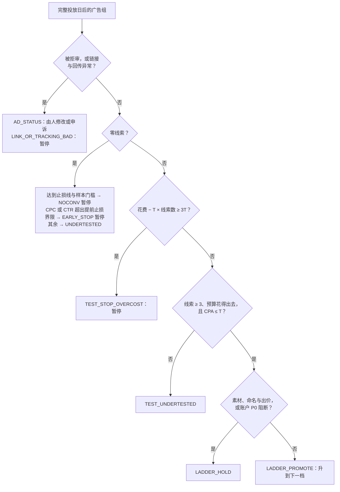
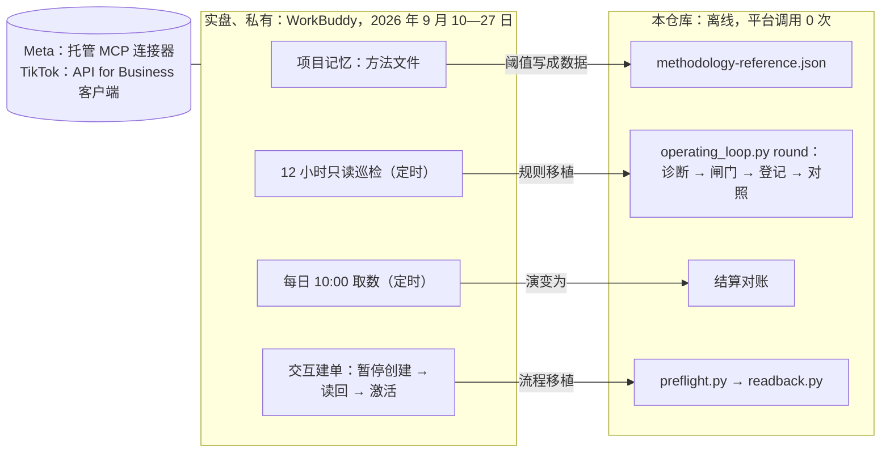
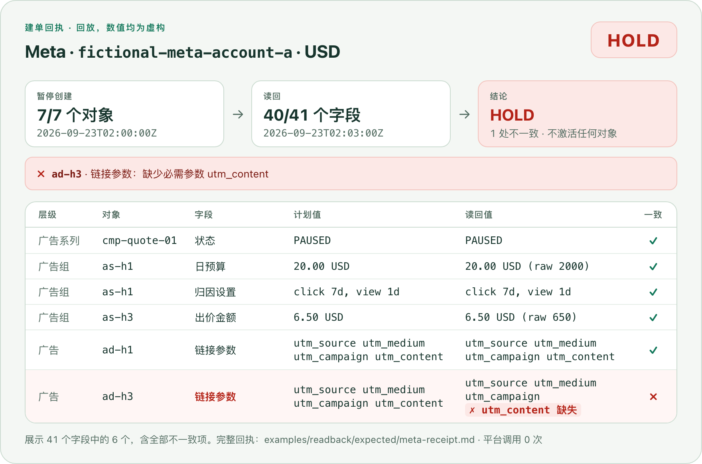

# Ad Ops Agent

[](https://github.com/creator2000212-crypto/ad-ops-agent/actions/workflows/ci.yml) [](.github/workflows/ci.yml)
[](#范围) [](LICENSE)

[English](README.md) · **简体中文**

**2026 年 9 月，我用 WorkBuddy（腾讯的桌面 AI Agent）在真实的 Meta 与 TikTok 线索投放账户上运行了一套广告运营护栏；本仓库把它重建为一个经过测试的离线决策引擎。**

这是一个广告运营（Ads Operations）作品集项目：面向 Meta 与 TikTok 线索投放的上线质检、变更管控以及平台与结算对账，并用护栏让 AI Agent 安全地承担重复性工作。

- **上线质检靠读回。** 每次建单都先暂停创建，再逐字段读回。只要一处不一致，整批就保持暂停；回执只展示平台实际返回的值。
- **没有闸门就不写入。** 每条拟改动都与写入前刚读到的状态比较，结果为 `ready`、`satisfied`、`conflict`、`unknown` 或 `advisory` 之一。`ready` 表示核对通过，不表示已批准。
- **规则来自单位经济，并与结算核对。** T 是目标 CPA：每条线索价值 × 线索通过率 ÷ 目标 ROAS。广告组只有在完整投放日内 CPA ≤ T 时才升一档（T → 2T → 3T，即基础预算的 1、2、3 倍），止损线以 T 计。全部阈值读自方法论文件，代码里没有默认值。平台数与结算导出对不上时，成本类决定降为仅建议。

```bash
git clone https://github.com/creator2000212-crypto/ad-ops-agent.git && cd ad-ops-agent
python3 demo/run_demo.py --lang zh-CN   # Python 3.9+，只用标准库；不需要账户或 API key
```

实盘操作 2026 年 9 月 10—27 日 · 9 月 24—25 日开源 · 定时任务自 9 月 26 日起暂停 → [实际是怎么跑的](docs/how-it-ran.zh-CN.md) · 哪些在实盘跑过、哪些是新增：[实盘与演示对照](docs/capability-status.zh-CN.md)

<p align="center"></p>
<p align="center"><sub>由 <code>scripts/render_visuals.py</code> 从演示轮次生成；没有任何数字是手填的。</sub></p>

## 它能拦住什么

每一行都是我操作账户或构建本仓库时真实出过的问题，以及本仓库里最接近的护栏。

| 出过的问题（2026） | 本仓库的护栏 |
|---|---|
| **9 月 10 日** · 25 条素材的批次超时，重试前先核对了已创建的对象 | 读回中出现计划里没有的对象（重试留下的重复）时，整批保持暂停。<br><sub>[`test_extra_object_from_a_retried_request_holds`](tests/test_readback.py)</sub> |
| **9 月 17 日** · 批量激活后有 8 条广告仍未生效，激活后的逐字段读回发现了它 | 任何改动之后都逐字段对照改后状态，没有落地的写入一直以“未生效”保持打开（上图中的 a10）。激活本身不在此回放。<br><sub>[`test_reconcile_detects_a_write_that_did_not_take_effect`](tests/test_operating_loop.py) · [`test_status_must_be_paused_before_activation`](tests/test_readback.py)</sub> |
| **9 月 20 日** · 广告平台连接断开，一个定时巡检拿到 0 个账户；它报告“无数据”，不下结论 | 缺失永远不等于零：没有账户的快照被拒绝，台账缺失直接报错。<br><sub>[`test_snapshot_without_accounts_is_rejected`](tests/test_operating_loop.py) · [`test_missing_ledger_raises`](tests/test_operating_loop.py)</sub> |
| **9 月 20 日** · 从所有已连接账户取数的日表，比合作方结算导出高出 19.6% | 平台与结算对账：只在一侧出现的行报告为范围缺口，绝不补零；超出容差的账户，其成本类决定降为仅建议。<br><sub>[`test_platform_only_account_is_scope_and_never_zero_filled`](tests/test_reconciliation.py) · [`test_gap_makes_a_promotion_advisory`](tests/test_reconciliation.py)</sub> |
| **9 月 20 日** · 建单脚本把受众自动化写死为关闭，与常设规则相反 | 尚未检查：受众自动化还不是读回或预检的字段（[WB-10](docs/case-studies.zh-CN.md#wb-10)）。设置与阈值写在数据文件里，读回会拒绝没有写明待核对字段的计划。<br><sub>[`test_rules_never_fall_back_to_a_code_default`](tests/test_operating_loop.py) · [`test_plan_must_state_fields_it_wants_checked`](tests/test_readback.py)</sub> |
| **9 月 22 日** · Agent 写的自动规则把阈值按美元填写，而接口要求美分，导致广告组被暂停 | 建单预算与出价按币种的最小单位位数换算；未知币种直接拒绝。自动规则本身不在本仓库的模型里。<br><sub>[`test_budget_minor_units_follow_currency_offset`](tests/test_readback.py)</sub> |
| **9 月 22 日** · Agent 把一条回答别的问题的回复当成了激活许可 | `ready` 与 ACTIVATE 只表示“核对通过”，从不表示“已批准”；批准必须指明批次（[AGENTS.md](AGENTS.md) R1）。<br><sub>[`test_only_ready_rows_enter_the_write_plan`](tests/test_operating_loop.py)</sub> |
| **9 月 25 日** · 回执生成器把 `ACTIVE` 写死，而读回实际是 `PAUSED` | 回执的值只来自读回文件；缺失的字段记为“未返回”。<br><sub>[`test_receipt_status_comes_from_readback_not_plan`](tests/test_readback.py)</sub> |
| **9 月 25 日** · 本仓库里我自己的 bug，当天修复：缺失或为 null 的基线被闸门判成 `ready` | 缺失或为 null 的基线一律是 `unknown`，不会是 `ready`。<br><sub>[`test_null_baseline_is_unknown_even_when_current_is_null`](tests/test_operating_loop.py)</sub> |

## 它怎样判定

一轮分五步：按方法论**诊断**每个广告组 → 用写入前刚读到的状态给每条拟改动**过闸门** → 把 ready 行**登记**进只追加台账 → 与改后状态**对照** → **交接**仍未闭合的事项。`python3 demo/run_demo.py --steps --lang zh-CN` 会逐步演示。每条规则对应的方法论键见[决策矩阵](docs/decision-matrix.md)。

| 规则 | 代码与测试 |
|---|---|
| T = 每条线索价值 × 线索通过率 ÷ 目标 ROAS | `target_cost()`<br><sub>`test_target_is_price_times_approval_over_roas`</sub> |
| 完整投放日内线索足够且 CPA ≤ T，升一档（T → 2T → 3T） | `decide_account()`<br><sub>`test_healthy_stage_promotes_and_doubles_budget` · `test_promotion_from_2T_targets_3T`</sub> |
| 止损线以 T 计；样本不足不下结论 | `decide_account()`<br><sub>`test_overcost_margin_triggers_stop` · `test_zero_conversion_below_sample_gate_is_not_judged`</sub> |
| 先处理素材或账户问题，再加预算 | `promotion_blockers()`<br><sub>`test_breaker_blocks_promotion` · `test_account_p0_blocks_promotion`</sub> |
| 单条素材以高 CPA 吃掉大部分花费时触发熔断 | `creative_findings()`<br><sub>`test_circuit_breaker_fires_on_concentration_and_cost`</sub> |
| 平台与结算对齐之后才做成本类决定 | `reconcile_settlement()`<br><sub>`test_settled_leads_are_compared_with_the_approval_rate`</sub> |
| 基于写入前读取状态的五态写入闸门 | `gate()`<br><sub>`test_conflict_when_current_value_matches_neither_baseline_nor_target`</sub> |
| 改后状态显示生效，改动才算数 | `reconcile()`<br><sub>`test_reconcile_detects_a_write_that_did_not_take_effect`</sub> |
| CPA 为什么变了：拆成 CPM、CTR、CVR 三项（本仓库新增） | `cpa_driver_decomposition()`<br><sub>`test_known_inputs_split_exactly`</sub> |
| 激活前的建单读回 | `verify_build()`<br><sub>`test_missing_url_parameter_holds_activation`</sub> |
| 创建任何对象之前的预检（本仓库新增） | `lint()`<br><sub>`test_max_name_with_cost_cap_fails`</sub> |

<details>
<summary><strong>单个广告组的判定树</strong></summary>


</details>

平台数与结算对不上的账户，其晋级和超成本止损降为仅建议；其余拟改动都要经过五态写入闸门。

[决策矩阵](docs/decision-matrix.md)（英文）由方法论生成并做漂移检查；下面是其中几条在方法论里的中文原文：

<!-- excerpt: examples/operating/methodology-reference.json -->
| 代码 | 级别 | 动作 | 响应时间 |
|---|---|---|---|
| `LADDER_PROMOTE` | P1 | 原组预算升到下一档（T -> 2T -> 3T，即基础预算的 1 / 2 / 3 倍） | 2-3 个完整投放日 |
| `LADDER_HOLD` | P2 | 本轮不晋级、预算不变；先处理同组的素材熔断 / 素材超上界 / 命名与出价不符，或账户级 P0 问题（每个广告组每轮只做一项变更） | 次轮 |
| `TEST_STOP_OVERCOST` | P0 | 暂停复核；回传未齐可先停新增花费 | 立即 |
| `AD_STATUS` | P0 | 读取拒审原因；修正素材、文案或落地页中的实质问题后提交审核，或通过平台官方复核渠道（Request Review）申诉；不得重新上传未修改或仅重新编码的素材。 | 2h |
<!-- /excerpt -->

**CPA 为什么变了。** CPA = CPM ÷ (1000 × CTR × CVR)，所以 CPA 的对数变化可以精确拆成 CPM、CTR、CVR 三项（对数点，括号内是该项占总变动的比例）。正数把 CPA 往上推，负数往下拉。下面摘自[演示报告](demo/expected/report.zh-CN.md)：a4 的上涨几乎全部来自 CVR，该查的是点击之后（落地页、表单、线索质量），不是竞价。这是会计恒等式，不是因果结论。

<!-- excerpt: demo/expected/report.zh-CN.md -->
| 广告组 | CPA：上期 → 本期 | Δ log CPA | CPM 贡献 | CTR 贡献 | CVR 贡献 | 主因 |
|---|---|---|---|---|---|---|
| `fictional-adset-a1` | 7.03 → 6.60 | -6.3 | +2.5 (22%) | -6.7 (60%) | -2.0 (18%) | **CTR** |
| `fictional-adset-a4` | 5.41 → 20.00 | +130.8 | +9.8 (7%) | +3.2 (2%) | +117.7 (90%) | **CVR** |
<!-- /excerpt -->

## 它在 WorkBuddy 里是怎么跑的

这些规则移植自我在 WorkBuddy 里设置的只读 12 小时巡检定时任务，它在 Meta 与 TikTok 线索投放实盘账户上运行（2026 年 9 月 22—26 日）。建单在交互会话中完成：暂停创建 → 逐字段读回 → 激活。本仓库是它的离线、带测试版本。



| WorkBuddy 任务 | 做什么 | 运行次数 | 结果 |
|---|---|---|---|
| 每日 10:00 取数（9 月 20 日创建） | 把昨天的 Meta 与 TikTok 数据写进固定 20 列的日表；缺源时写明缺哪一路，不补零；从不合并过期文件 | 7（9 月 21—26 日） | 5 次交付，1 次失败，1 次手动测试被中断 |
| 12 小时只读巡检（9 月 22 日创建） | 先在只追加台账里回验上一轮动作 → 取数 → 按 T 阶梯给每个广告组分类 → 动作清单 → 报告 | 7（9 月 22—26 日） | 6 次交付，1 次失败 |
| 2 小时巡检（9 月 20 日创建，当天删除） | 唯一一次运行时广告平台连接已断开，拿到 0 个账户 | 1 | 报告“无数据，不下结论” |

两个周期任务都跑在应用的本地调度器上，只在笔记本唤醒时运行，自 9 月 26 日起暂停。12 小时巡检的只读是靠指令约束，不是靠权限限制。运行记录、时间线与不足：[实际是怎么跑的](docs/how-it-ran.zh-CN.md)。

<p align="center"></p>
<p align="center"><sub><code>readback.py</code> 的 Meta 示例 · 完整回执：<a href="examples/readback/expected/meta-receipt.zh-CN.md">meta-receipt.zh-CN.md</a> · <a href="docs/build-qa.zh-CN.md">建单质检</a></sub></p>

## 案例

十个来自实盘账户的案例，每个都落到本仓库的一条护栏（[全部案例](docs/case-studies.zh-CN.md)；方法怎样演变：[方法演变](docs/methodology-history.zh-CN.md)）：

- [WB-01](docs/case-studies.zh-CN.md#wb-01)：20 条待建广告在创建前留待审阅 → 预检中的重复文件检查
- [WB-02](docs/case-studies.zh-CN.md#wb-02)：三条业务线的 TikTok 建单逐对象交接 → 逐字段读回回执
- [WB-03](docs/case-studies.zh-CN.md#wb-03)：缺源时日报明确标为不完整 → 缺失不等于零
- [WB-04](docs/case-studies.zh-CN.md#wb-04)：单位错 100 倍的自动规则被定位、撤回并改为只通知 → 按币种换算金额
- [WB-05](docs/case-studies.zh-CN.md#wb-05)：每轮先回验上一轮动作 → 只追加台账
- [WB-06](docs/case-studies.zh-CN.md#wb-06)：复核发现回执把 `ACTIVE` 写死 → 回执只来自带时间的读回
- [WB-07](docs/case-studies.zh-CN.md#wb-07)：0 账户的运行报告“无数据”，而不是“一切正常” → 空输入明确失败
- [WB-08](docs/case-studies.zh-CN.md#wb-08)：含糊回复后批次被激活 → 显式的批准关卡
- [WB-09](docs/case-studies.zh-CN.md#wb-09)：日表与结算的差异从约 20% 缩小到约 0.1% → 结算对账
- [WB-10](docs/case-studies.zh-CN.md#wb-10)：与常设规则矛盾的建单脚本被修复并加上审计 → 设置写在数据里，不写在代码里

## 分工

运营规则、阈值和写入关卡的行为由我根据亲自操盘的投放定义，上线和预算调整由我批准，Agent 负责执行。WorkBuddy 中的技能、脚本和定时任务由 Agent 按我的指示创建。本仓库的代码和文档由 AI 编程 Agent 起草；决策引擎及其测试由我提出规格并审阅。

## 范围

> **按设计离线运行。** 这里的每个模块都只读取本地文件（JSON；原型的模拟与私有记忆库使用 SQLite），平台调用为 0；示例数据均为虚构。实盘读写通过 WorkBuddy 的连接器完成，通常经我批准（两次例外 [WB-04](docs/case-studies.zh-CN.md#wb-04) 与 [WB-08](docs/case-studies.zh-CN.md#wb-08) 正是自动规则改为只通知、上线批准成为显式关卡的原因）；这些访问权限都不随本仓库提供。规划与接入模块（`onboarding.py`、`guidance.py`、`methodology.py`、`planning.py`、`task.py`、`adops.py` 及其辅助模块）是另一个上线前的原型，不属于实盘运行的部分。详见[实盘与演示对照](docs/capability-status.zh-CN.md)。

## 仓库结构

| 路径 | 内容 |
|---|---|
| [`operating_rules.py`](operating_rules.py) | 判定规则、结算对账、CPA 拆解与五态写入闸门 |
| [`operating_loop.py`](operating_loop.py) | 一轮巡检（诊断 → 闸门 → 登记 → 对照）与只追加台账 |
| [`readback.py`](readback.py) · [`preflight.py`](preflight.py) | 建单读回回执（HOLD / ACTIVATE）与预检 |
| [`demo/`](demo/README.zh-CN.md) · `examples/` | 回放演示及已提交的预期输出（中英文）；`operating/`、`readback/`、`preflight/` 的虚构示例数据 |
| [`docs/`](docs/index.md) | 实际运行记录、案例、建单质检、决策矩阵、方法演变 |
| [`AGENTS.md`](AGENTS.md) | 给在真实账户上使用本项目的 Agent 的指令 |
| `scripts/` · `tests/` | 决策矩阵与图片生成脚本、仓库检查；unittest 测试（`python3 -m unittest discover -s tests`） |

## 许可

[MIT](LICENSE)。[NOTICE](NOTICE.md) · [更新日志](CHANGELOG.md) · [SECURITY](SECURITY.md) · [贡献](CONTRIBUTING.md)。本仓库不包含私有投放记录、凭据、素材或 WorkBuddy 会话数据。本项目与腾讯无关联。
